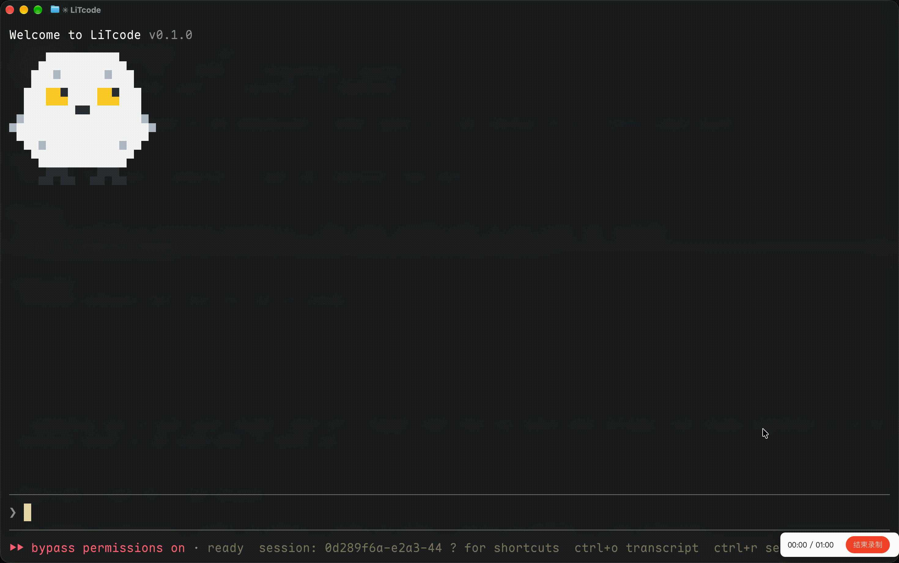

# LiTcode



LiTcode 是一个可自行配置模型的终端 AI 编程助手，提供交互式编程与本地任务执行。

- 文件读写、代码编辑与 Shell 执行
- 会话恢复、上下文压缩与本地记忆
- Skills、Hooks、插件、MCP 与 LSP 扩展
- 子代理、后台任务、定时调度与工作流

模型通过 Messages 网关接入，Magpie 负责路由与协议转换。项目持续完善中。

## 安装

准备 Node.js 22 或更新版本、npm 和 Git。安装 `ripgrep` 可供代码搜索使用。macOS 构建还需 Xcode Command Line Tools，可用 `xcode-select --install` 安装。当前开发验证环境为 macOS 和 Node.js 26，Windows 尚未验证。

从源码安装，克隆私有仓库时使用有访问权限的 GitHub 账号：

```sh
git clone https://github.com/smf3kt/cc_reverse.git
cd cc_reverse
npm ci --ignore-scripts
npm run build
npm link
```

安装后查看帮助和版本：

```sh
litcode --help
litcode --version
```

也可在仓库内直接运行编译版，省略全局安装：

```sh
node bin/litcode.mjs --help
node bin/litcode.mjs --demo
```

`--demo` 在临时目录演示文件写入、读取和会话记录，无需模型凭证。

## 配置模型

先启动 Magpie 或其他兼容 Messages 协议的网关，再设置连接信息。将示例中的密钥和模型 ID 替换为网关提供的值：

```sh
export LLM_API_KEY='your-gateway-key'
export LLM_BASE_URL='http://127.0.0.1:3425'
export LLM_MODEL='your-model-id'
export LLM_AUTH='bearer'
litcode
```

`LLM_BASE_URL` 是网关根地址，客户端追加 `/v1/messages`。使用 `x-api-key` 的网关将 `LLM_AUTH` 设为 `api-key`。

已有兼容客户端配置时，LiTcode 默认继承缺少的模型、网关和凭证。加上 `--no-inherit-gateway` 可仅使用本项目的配置。API 密钥通过环境变量或本地凭证存储读取，设置文件只填写非秘密配置。

## 基本使用

在当前目录打开交互会话，或指定现有项目目录：

```sh
litcode
litcode --workspace /path/to/project
```

输入任务后按 Enter 提交。`Ctrl+C` 取消正在执行的任务，`/exit` 退出会话。`litcode --no-tui` 使用行编辑界面。

直接执行一次任务：

```sh
litcode --workspace /path/to/project "检查测试失败的原因并修复"
```

Shell 默认开启，命令使用当前系统用户权限。`/permissions` 管理工具权限，`/plan` 进入只读分析模式。

会话保存在工作区的 `.agent/` 目录。查看记录并继续任务：

```sh
litcode --workspace /path/to/project --list-sessions
litcode --workspace /path/to/project --resume UUID "继续处理下一项"
litcode --workspace /path/to/project --resume UUID --continue
```

`--continue` 接续中断的回合。恢复会话沿用保存的模型和配置，交互模式也可用 `/resume` 选择会话。

## 常用命令

| 命令 | 用途 |
| --- | --- |
| `/help` | 查看命令和技能 |
| `/status`、`/context`、`/usage` | 查看会话状态、上下文和 token 用量 |
| `/model`、`/config`、`/theme` | 选择模型、修改设置和终端主题 |
| `/plan`、`/permissions` | 进入计划模式、管理工具权限 |
| `/tasks`、`/workflows`、`/cron` | 查看后台任务、工作流和定时任务 |
| `/skills`、`/agents`、`/mcp` | 查看技能、代理类型和 MCP 连接 |
| `/reload` | 重新加载本地配置和扩展 |
| `/compact` | 手动压缩已完成的上下文 |
| `/resume`、`/clear`、`/exit` | 恢复会话、新建会话和退出 |

## 本地配置与扩展

用户设置位于 `~/.harness/settings.json`，项目设置位于 `.harness/settings.json`。项目本地覆盖使用 `.harness/settings.local.json`，Git 工作区内以所属仓库根目录为准。`--user-dir DIR` 指定用户目录，`--settings FILE` 额外载入设置文件。

例如，项目设置可写为：

```json
{
  "model": "your-model-id",
  "baseURL": "http://127.0.0.1:3425",
  "theme": "dark",
  "autoMemory": true
}
```

技能放在用户目录的 `skills/<name>/SKILL.md` 或项目 `.harness/skills/<name>/SKILL.md`，用 `/name` 调用。项目指令使用 `HARNESS.md`、`AGENTS.md` 和 `.harness/rules/`。MCP 服务通过设置中的 `mcpServers` 配置，连接状态在 `/mcp` 查看。

## 开发

```sh
npm run check
npm test
npm run build
npm run agent -- --demo
```

修改源码后重新构建，`litcode` 使用 `dist/` 中的编译结果。项目采用 [MIT 许可证](LICENSE)。
